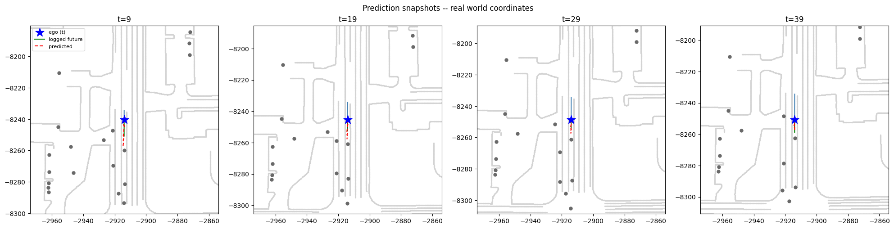

# Waymax Experiments

This project is about learning how a self driving car might understand the
world around it and predict where it will go next.

The starting idea was pretty simple: when we drive, we don't pay attention to
everything around us. We only really track a handful of things that matter,
and we often already know where we're headed (like a turn coming up) well
before we get there. The goal here was to try building something along those
lines, where a model learns to focus on the agents and parts of the scene
that actually matter, instead of treating everything around it as equally
important.

## What exists right now

A model that looks at a driving scene (nearby cars, the road layout, traffic
lights) from the car's own frame of reference, and predicts the car's future
trajectory.

The architecture has three encoder branches:

- Agents (everything except the ego car): each one gets a short history
  window of position, heading, and velocity, run through its own GRU, plus
  an embedding for its object class (vehicle, pedestrian, cyclist).
- Static map points (lane markings, stop signs, crosswalks): passed through
  an MLP, each point's type also gets its own learned embedding, since these
  don't move over time so there's no need for a GRU here.
- Traffic lights: same idea as agents, a GRU over history, since light state
  changes over time, plus an embedding for the current state.

Each branch pools its items (agents, map points, or lights) into one vector
using a softmax over a learned relevance score per item, instead of a plain
average. This is the main design choice in the project: the model decides
how much to weight each surrounding car or map point rather than treating
all of them as equally important, and padded/invalid slots get a weight of
exactly zero through the softmax's minus infinity trick.

The three pooled vectors are concatenated together with the ego car's own
current yaw and speed, and this combined vector is passed through a decoder
MLP that outputs the predicted future trajectory directly.

What goes into each branch is a region of interest around the car at the
moment of the decision (`src/features.py`, shared by training and the
closed loop so they can't drift apart):

- agents: everyone visible right now within 50 m, nearest 32. If the
  tracker lost an agent for a few frames within its 1 s history (occlusion
  happens a lot in real logs), those frames are interpolated and flagged
  with an extra "observed" feature, instead of dropping the agent entirely.
- map: every roadgraph point within 80 m, nearest first.
- traffic lights: visible now, within 80 m, nearest first.

Everything (positions, velocities, map points, light positions) is
transformed into the ego car's own coordinate frame before being fed in,
since what matters for driving is where something is relative to you, not
its position in some arbitrary global frame. As of the latest retrain, this
transform is time-matched (each historical instant uses the ego's own state
*at that instant*, not its state right now) rather than anchoring the whole
history window to a single current-instant pose -- matters most for
velocity, and mostly during turns/braking (see `src/transforms.py`).

It's trained and tested on real driving logs from the Waymo Open Motion
Dataset, using the Waymax simulator. There are some visualizations too, the
real driving clip alongside what the model predicted, so it's easy to see how
it's actually doing rather than just looking at a loss number.



A note on scale: the full dataset has hundreds of thousands of scenarios, and
what's been run so far only uses a portion of it, capped mainly to keep
training times reasonable while things are still being worked out. Worth
keeping in mind when looking at any numbers here, they're not yet from the
full dataset.

### Retrain with bug fixes

Task 2 fixed how the history features were computed: an agent's velocity
at each past moment was being compared against the ego's velocity *now*,
not at that same moment, which mixed the ego's own acceleration into every
agent's features (worst during turns and braking). Going through the
retraining for that turned up more issues with what the model was being
fed:

- agents had to be visible in every one of the 10 history frames, so any
  tracker dropout removed them completely, and there was no distance filter
  or ranking at all;
- the map branch got the first 200 points within 80 m in array order,
  essentially an arbitrary subset of the road;
- the data loader was capped at 32 objects, which Waymax applies in file
  order -- so nearby cars could be cut, and when the ego itself was cut,
  some other object was silently treated as the ego.

The training run itself also had problems: the learning rate schedule was
set up for 5 epochs but ran for 10 (so the LR climbed back up for the last
few epochs), and test numbers came from the last epoch instead of the saved
best checkpoint.

All of these are fixed on the `meeting-prep` branch, and the model is
retrained from scratch with them (`notebooks/Av2_retrain_meeting_prep.ipynb`).
Since the earlier models were trained on partly wrong inputs, their ADE/FDE
aren't compared against here -- these numbers are the new baseline.

<!-- RESULTS: paste the table printed at the end of Av2_retrain_meeting_prep.ipynb here -->
_Results pending: this run hasn't been done yet._

The same notebook also runs a branch ablation (hide agents / map / lights
at inference and see how much the prediction changes), to check whether the
model actually uses the scene or mostly extrapolates its own speed.

## Stage 2: closed-loop MPC planner

On top of the Stage 1 encoder, `src/dynamics.py` + `src/mpc.py` +
`src/closed_loop.py` add a receding-horizon planner: the encoder's predicted
trajectory becomes a reference, `mpc.py` samples cone-constrained candidate
control sequences around it, scores them against a collision/progress/
comfort cost (with other agents projected forward via IDM car-following,
each one path-following its own logged route's curvature rather than a
frozen heading), and executes the first control of whichever candidate wins
before replanning from the new real state. `closed_loop.py` wires this into
a real per-step simulation where both the ego and other agents run their own
dynamics instead of replaying the log.

Status: implemented and unit-tested against synthetic scenarios (see
`tests/`). The first runs against real Waymax scenarios
(`Av2_closed_loop.ipynb`) surfaced two issues, both addressed on the
`meeting-prep` branch:

- The path-following agents assumed each object appears, drives and
  disappears exactly once. On real data 95% of scenarios have at least one
  object that drops out for a few frames and comes back, and the code
  refused those scenarios, leaving 2 usable out of 60. Now gaps of up to
  1 s are bridged (the agent stays in the sim, its path interpolated) and
  longer gaps split the object into separate appearances.
- The planner's cost rewarded covering distance in any direction, so with
  nothing else pulling on speed it sped up (18 m/s while the human was
  nearly stopped). There's now an opt-in calibrated cost (progress measured
  along the heading, plus a penalty on deviating from the reference's
  speed). It's run side by side with the original in
  `notebooks/Av2_closed_loop_meeting_prep.ipynb`. It's a first calibration,
  not a tuned one.

Also: every agent is still simulated, but only those within 50 m enter the
planner's candidate rollouts, and the model sees the same region-of-interest
selection as in training.

<!-- RESULTS: closed-loop summary table from Av2_closed_loop_meeting_prep.ipynb -->
_Results pending._

## What this could become

The closed-loop planner above is the "combine with a proper planner" step
this section used to describe as future work -- now built, being debugged
against real data. From here:

- Depending on what the ablation shows: if the model barely uses the
  scene, look at what it's missing first -- it currently gets the ego's
  current speed only (no ego history, acceleration or yaw rate) and no idea
  of where the car is headed (route/goal).
- Predict several possible futures instead of one. A single MSE-trained
  trajectory averages between options (turn vs go straight) and lands in
  between, which is consistent with the "keeps doing what it's doing" bias.
  A distribution would also give the planner something principled to sample
  from.
- On the planner side: time-correlated sampling noise (smoother candidates
  than independent per-step noise), warm-starting from the previous step's
  plan, and proper cost tuning.
- Possibly compare against Waymax's own built-in IDM agents and metrics
  (off-road, overlap, log divergence) instead of only our own.
- The agent region of interest is a fixed 50 m for now; making it depend on
  speed (or on where the car is headed) is an easy next step.
- There's also more to explore around the "only pay attention to a few
  things" idea itself, being more selective about which agents actually
  matter, tied to where the car is actually headed, rather than looking at
  everyone nearby all the time -- deliberately deferred until the
  closed-loop planner above is confirmed working end-to-end.


## Repo layout

```
src/
  features.py      what the model sees: ROI selection, dropout filling (shared)
  transforms.py    ego frame conversions (time-matched/tau, see above)
  model.py         the Stage 1 model itself
  extract.py       pulls one training example out of a scenario
  dataset.py       splits data into train, val, test
  train.py         the training loop
  visualize.py     playback and prediction plots
  metrics.py       ADE, FDE
  dynamics.py      kinematic bicycle model (Stage 2)
  mpc.py           cone-constrained MPC + IDM car-following (Stage 2)
  closed_loop.py   wires encoder -> MPC -> dynamics into a real rollout (Stage 2)
tests/
  test_mpc.py            dynamics/mpc unit tests, synthetic data
  test_closed_loop.py    closed-loop wiring + path-following agent tests
  test_transforms.py     time-matched (tau) vs decision-instant (t) regression test
  test_features.py       ROI selection, dropout filling, map selection
notebooks/
  Av2_retrain_meeting_prep.ipynb       retrain with bug fixes + diagnostics + ablation (Colab)
  Av2_closed_loop_meeting_prep.ipynb   closed loop on real scenarios, both costs (Colab)
weights/
  stage1_weights.pth        pre-tau baseline (old selection, 6 agent features)
  best_weights_v2.pth       pre-tau baseline, best-of-run (old selection, 6 agent features)
  stage1_weights_tau.pth    first tau retrain (old selection, 6 agent features)
  stage1_weights_roi.pth    produced by Av2_retrain_meeting_prep.ipynb -- current
```

The three older checkpoints were trained with 6 agent features; load them
with `Stage1Model(agent_feat_dim=6)`. They don't match the current feature
extraction, so they're kept as a record rather than for use.
