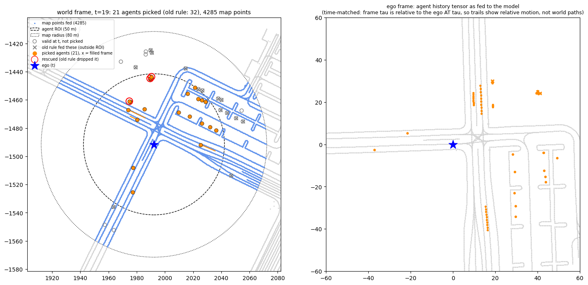
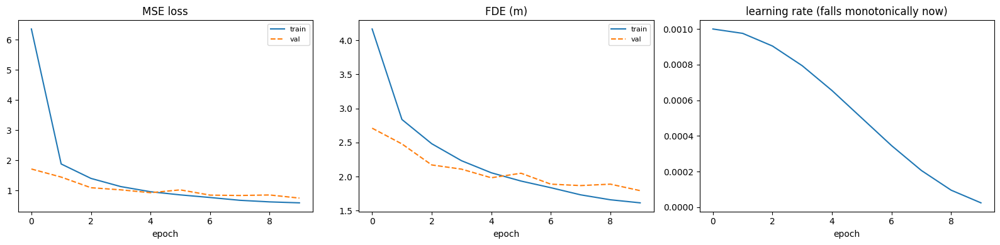
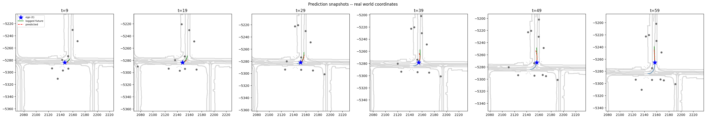
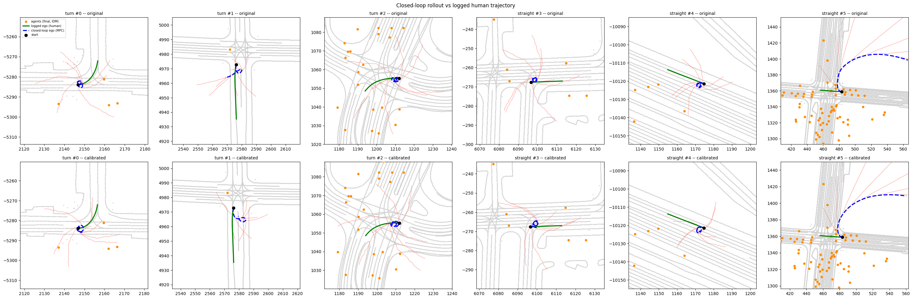
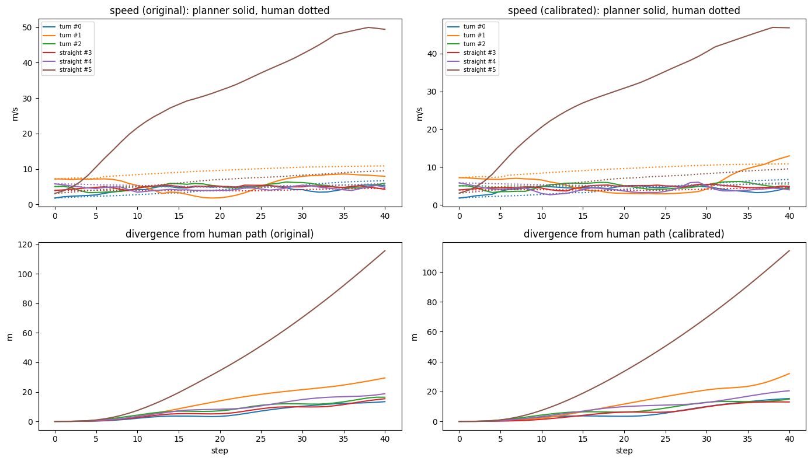

# Waymax Experiments

This project is about how a self-driving car might understand the world
around it and decide where to go next.

The starting idea: when we drive, we don't pay attention to everything
around us. We track a handful of things that matter, and we usually know
where we're headed well before we get there. The goal is a model that learns
to focus on the agents and parts of the scene that matter, instead of
treating everything equally.

It's trained and tested on real driving logs from the Waymo Open Motion
Dataset (WOMD), using the Waymax simulator.

## Where this started: prediction only

The first version was a pure prediction model. Given the last second of a
scene (nearby cars, the road layout, traffic lights), it predicts where the
ego car will be over the next 3 seconds.

The model has three encoder branches:

- **Agents**: a GRU over each agent's recent history, plus its class
  (vehicle, pedestrian, cyclist).
- **Map**: road points (lane lines, crosswalks, stop signs) through a small
  MLP, plus their type.
- **Traffic lights**: a GRU over each light's recent states.

Each branch combines its items with a learned relevance weight per item
instead of a plain average. This is the "pay attention to what matters"
part. The three summaries plus the ego's speed go through a decoder that
outputs the 3 s trajectory. Everything is expressed relative to the ego car.

That model implicitly learned where the car goes given what everyone else is
doing. But its predictions were just predictions: nothing happened as a
consequence of them. The car never actually drove, and nobody reacted to it.

## What changed since

### 1. Correct relative velocities

Each past frame of an agent's history was measured against where the ego is
*now*, not where the ego was *at that frame*. For velocity this mixes two
moments in time, so the ego's own braking or turning leaked into every
agent's features. Now every past frame is measured against the ego's state
at that same moment (`src/transforms.py`).

### 2. What the model looks at

Going through the data for the retrain turned up problems with what the
model was being fed. The selection now lives in one place
(`src/features.py`), shared by training and the closed loop:

| | before | now |
|---|---|---|
| agents | had to be tracked in all 10 history frames, any distance, first 32 in file order | visible now, within 50 m, nearest 32 |
| tracking dropouts | agent dropped entirely | short gaps interpolated and flagged as "filled in" |
| map | first 200 points within 80 m, in file order | every point within 80 m, nearest first |

On 150 validation scenes:

- In 65% of decision moments, the old rule threw away at least one nearby
  agent because of a short tracking dropout.
- The old rule also fed about 6 agents per moment from more than 50 m away.
- The map within 80 m holds about 6,400 points (median), so 200 points in
  file order was an arbitrary slice of the road.



*Left: coloured map points and orange agents are what the model gets. Red
rings are agents the old rule dropped, grey crosses are far agents the old
rule fed instead. Right: the agent input exactly as the model sees it.*

The training setup also had a learning-rate schedule bug (set for 5 epochs
but run for 10) and reported test numbers from the last epoch rather than
the saved best checkpoint. Both are fixed.

### 3. Retrained model

Retrained from scratch with all of the above (10 epochs, 2,000 training
scenarios, `notebooks/Av2_retrain_meeting_prep.ipynb`). Since the old models
were trained on partly wrong inputs, these numbers are a new baseline rather
than a comparison.

| test set (300 scenarios) | ADE (m) | FDE (m) |
|---|---|---|
| all | 0.66 | 1.78 |
| straight | 0.56 | 1.52 |
| turning | 1.22 | 3.39 |



Validation error was still improving at the last epoch, so more data or
epochs should help further.



*Green: what the human did. Red dashed: the model's prediction.*

To check whether the model actually uses the scene, each branch was hidden
at test time:

| hidden | ADE change |
|---|---|
| agents | +62% |
| traffic lights | +13% |
| map | +5% |
| everything | +89% |

So the model relies heavily on other agents and on traffic lights, but
hardly on the map. Turns are where it struggles most, which is where the
map should matter most. Improving how the map is encoded is the obvious
next step for the model.

## Closed loop: the pipeline now exists

The next step was letting the car actually drive, so that its decisions have
consequences. Every 0.1 s:

1. The model predicts the next 3 s from the current scene.
2. The planner treats that prediction as a reference path. It samples
   variations of it, kept inside a cone that widens from 1 m at the first
   step to 10 m at the last.
3. Each candidate is scored on collisions, progress and comfort, with the
   other cars reacting to it.
4. The car executes only the first step of the best candidate, and the
   whole thing repeats from where it actually ended up.

The other cars follow their own logged paths, but their speed is controlled
by a car-following model (IDM), so they brake if the ego cuts in front or
slows down ahead of them. The ego itself follows a kinematic bicycle model.

Running this on real scenes first hit the dropout problem: 94% of scenarios
have at least one car that disappears for a few frames, which the agent
simulation couldn't handle. Gaps up to 1 s are now bridged by interpolating
the car's path; longer gaps are treated as the car leaving and coming back.
Most gaps turned out to be a single frame. Every scenario now runs.



*Six real scenes, 4 s each. Green: the human. Blue dashed: our planner. Thin
red: the model's prediction every 0.5 s. Top row: original cost. Bottom row:
a calibrated cost that also tracks the predicted speed.*

The pipeline runs end to end, with no collisions in these runs, but the
driving isn't right yet:

- In most runs the car turns in tight circles.
- In one run it keeps accelerating, to about 50 m/s.

Both trace back to the planner rather than the model. It turns the first
predicted point (0.1 s ahead) directly into a steering command, and nothing
limits steering or acceleration. At low speed, a 5 cm error in that first
point becomes a 73 degree steering angle. Changing the cost function alone
made no measurable difference, which is why the next work is on the planner
itself.



## Next steps

- **Planner**: limit steering and acceleration, steer towards a point
  further ahead instead of the first one, then tune the cost function.
- **Sampling**: smoother candidates (noise that's correlated over time
  rather than independent each step), and starting each step from the
  previous plan instead of from scratch.
- **Model**: a better map encoding (lanes as polylines rather than one
  pooled vector), the ego's own recent motion as an input, and where the
  car is headed (route).
- **Multiple futures**: predict a few possible trajectories instead of one,
  so the planner has a real distribution to sample from.
- **Region of interest**: fixed at 50 m for now; could depend on speed.

## Running it

Both notebooks run on Colab (Waymax data access is easiest there) and
include their outputs:

- `notebooks/Av2_retrain_meeting_prep.ipynb`: data checks, training,
  test results, branch ablation.
- `notebooks/Av2_closed_loop_meeting_prep.ipynb`: closed loop on real
  scenes.

Unit tests (no Waymax needed): `python -m tests.test_features`,
`tests.test_transforms`, `tests.test_mpc`, `tests.test_closed_loop`.

## Repo layout

```
src/
  features.py      what the model sees: region of interest, dropout filling
  transforms.py    ego-frame conversions
  model.py         the prediction model
  extract.py       builds one training example from a scenario
  dataset.py       train / val / test split
  train.py         training loop, branch ablation
  visualize.py     plots, including what the model is fed
  metrics.py       ADE, FDE
  dynamics.py      kinematic bicycle model
  mpc.py           planner: sampling, IDM agents, cost
  closed_loop.py   model + planner + agents, stepped together
tests/             unit tests on synthetic scenes
notebooks/         the two Colab notebooks above, with outputs
figures/           figures used in this README
weights/
  stage1_weights_roi.pth    current model
  stage1_weights.pth, best_weights_v2.pth, stage1_weights_tau.pth
                            older models, trained on the old inputs
```
